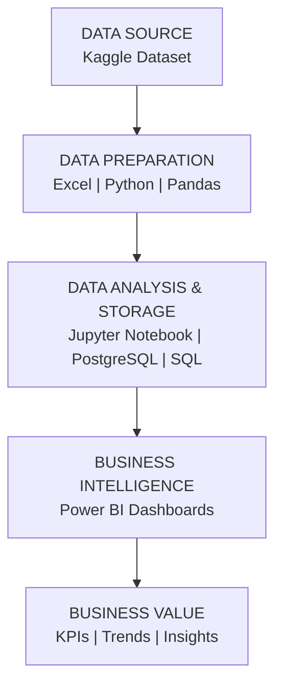

# 🚢 UAE Supply Chain Analytics

### End-to-End Data Analytics | Python | SQL | PostgreSQL | Power BI

<p align="center">
  
  
  
  
  
  
</p>

---

## 📌 1. Project Overview

The **UAE Supply Chain Analytics** project is an end-to-end data analytics and business intelligence project focused on analyzing supply chain operations, sales performance, warehouse inventory, and supplier performance.

The project uses Python, Microsoft Excel, PostgreSQL, SQL, and Power BI to transform raw supply chain data into structured datasets, analytical findings, and interactive dashboards.

The main objective is to provide business visibility through key performance indicators (KPIs), identify operational patterns, and support data-driven decision-making.

## 🎯 2. Business Objectives

* Analyze sales and revenue performance.
* Identify top-performing products and regions.
* Monitor warehouse inventory levels.
* Analyze stock distribution and reorder requirements.
* Evaluate supplier performance and lead times.
* Compare promotional and non-promotional sales.
* Develop interactive dashboards for business monitoring.

---

## 🛠️ 3. Tools & Technologies

| Technology       | Application                               |
| ---------------- | ----------------------------------------- |
| Kaggle           | Dataset Source                            |
| Microsoft Excel  | Data Inspection and Preparation           |
| Python           | Data Cleaning and Transformation          |
| Jupyter Notebook | Exploratory Data Analysis                 |
| Pandas           | Data Manipulation                         |
| NumPy            | Numerical Operations                      |
| PostgreSQL       | Database Management                       |
| SQL              | Data Querying and Analysis                |
| Power BI         | Interactive Dashboard Development         |
| GitHub           | Project Documentation and Version Control |

---

## 🏗️ 4. Project Architecture

The project follows an end-to-end analytics workflow, covering data collection, preparation, analysis, database management, and business intelligence reporting.



### Project Workflow

* **Data Collection:** Obtain the original supply chain dataset from Kaggle.
* **Data Preparation:** Inspect, clean, and transform the raw dataset.
* **Exploratory Data Analysis:** Explore data patterns and trends using Python.
* **Database Management:** Organize and manage structured data using PostgreSQL.
* **SQL Analysis:** Query and analyze business-related information.
* **Data Visualization:** Develop interactive Power BI dashboards.
* **Business Intelligence:** Present KPIs and analytical findings to support business decisions.

---

## 📁 5. Repository Structure

```text
UAE-Supply-Chain-Analytics/
│
├── 01_Raw_Data/
│
├── 02_Cleaned_Data/
│
├── 03_Python/
│
├── 04_SQL/
│
├── 05_PowerBI/
│
├── 06_Screenshots/
│   ├── 01_Executive_Overview.png
│   ├── 02_Sales_Performance.png
│   ├── 03_Warehouse_Inventory.png
│   ├── 04_Supplier_Performance.png
│   └── README.md
│
└── README.md
```

---

# 📊 6. Power BI Dashboard

The Power BI report contains four analytical pages covering executive performance, sales, warehouse inventory, and supplier operations.

## 6.1 Executive Overview

**Objective:** Provide a consolidated overview of supply chain business performance through key metrics and visual summaries.


**Key Metrics**

* Total Revenue
* Total Units Sold
* Total Records
* Total Inventory

**Analysis Areas**

* Revenue performance
* Regional sales trends
* Overall business performance
* Inventory overview

**Business Value**

Provides management with a consolidated view of key business indicators to monitor overall performance.

---

## 6.2 Sales Performance

**Objective:** Analyze revenue generation, product performance, and sales trends.


**Analysis Areas**

* Monthly and quarterly sales trends
* Top-performing products
* Promotional vs. non-promotional revenue
* Daily sales performance
* Revenue comparisons

**Business Value**

Helps identify sales patterns, understand product contribution, and evaluate promotional performance.

---

## 6.3 Warehouse & Inventory

**Objective:** Monitor inventory distribution, warehouse stock levels, and replenishment requirements.


**Analysis Areas**

* Inventory by warehouse
* Reorder requirements
* Regional inventory distribution
* Stock status
* Warehouse-level comparisons

**Business Value**

Supports inventory monitoring, helps identify potential stock shortages, and improves replenishment planning.

---

## 6.4 Supplier Performance

**Objective:** Evaluate supplier efficiency, lead times, order quantities, and cost-related performance.


**Analysis Areas**

* Supplier-wise performance
* Supplier lead time comparison
* Order quantity analysis
* Supplier unit cost analysis
* Supplier contribution

**Business Value**

Helps compare supplier performance and supports procurement and supplier evaluation decisions.

---

## 📈 7. Key Performance Indicators

The following KPIs are displayed in the project dashboard.

| KPI              | Reported Value |
| ---------------- | -------------: |
| Total Revenue    |     AED 33.43M |
| Total Units Sold |             2M |
| Total Records    |            91K |
| Total Inventory  |            43M |
| Total Suppliers  |             10 |

*Note: KPI values reflect the reported dashboard figures and may change depending on applied filters.*

---

## 💡 8. Business Insights & Applications

### Sales & Revenue Analysis

* Monitor revenue trends and product contribution.
* Compare promotional and non-promotional sales.
* Identify products contributing to revenue.
* Understand sales performance across periods.

### Inventory Management

* Monitor stock distribution across warehouses.
* Review inventory replenishment requirements.
* Identify potential stock shortages.
* Support inventory planning.

### Supplier Performance

* Compare supplier lead times and costs.
* Analyze supplier order quantities.
* Review supplier contribution.
* Support supplier evaluation.

### Business Decision Support

* Improve visibility into supply chain operations.
* Support sales and inventory planning.
* Monitor key business performance indicators.
* Enable data-driven operational decisions.

---

## 🧠 9. Skills Demonstrated

* Data Collection and Preparation
* Data Cleaning and Transformation
* Exploratory Data Analysis (EDA)
* Python Programming
* Pandas and NumPy
* Microsoft Excel
* SQL Querying
* PostgreSQL Database Management
* Power BI Dashboard Development
* Data Visualization
* KPI Analysis
* Business Intelligence

---

## 📂 10. Dataset Information

**Dataset Name:** High-Dimensional Supply Chain Inventory Dataset
**Source:** Kaggle

**Original Dataset:** [View Dataset on Kaggle](https://www.kaggle.com/datasets/ziya07/high-dimensional-supply-chain-inventory-dataset)

The dataset is used for data preparation, exploratory analysis, SQL querying, and Power BI dashboard development.

---

## 👨‍💻 11. About Me

### Anthony Raj I

**Data Analyst | Power BI | MIS Reporting**

📍 Abu Dhabi, UAE

I am passionate about transforming raw data into meaningful business insights through data analytics, reporting, and interactive business intelligence dashboards.

**Technical Skills**

* Microsoft Excel
* Python
* SQL & PostgreSQL
* Power BI
* Data Analytics
* Data Visualization
* Business Intelligence

### Connect With Me

* **LinkedIn:** [Anthony Raj](https://www.linkedin.com/in/anthony-raj/)
* **GitHub:** [Anthony Raj Analytics](https://github.com/anthony-raj-analytics)
* **Email:** [arraja1920@gmail.com](mailto:arraja1920@gmail.com)

---

<p align="center">
  <b>⭐ Thank you for visiting my project!</b>
  <br>
  Feedback and suggestions are welcome.
</p>
