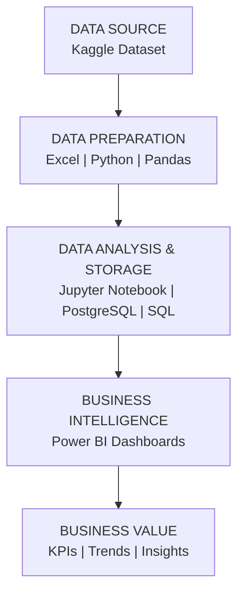

# 🚢 UAE Supply Chain Analytics

### End-to-End Data Analytics | SQL | Python | Power BI

<p align="center">
  
  
  
  
  
  
</p>

---

## 📌 Project Overview

The **UAE Supply Chain Analytics** project is an end-to-end data analytics and business intelligence solution designed to analyze supply chain operations, sales performance, warehouse inventory, and supplier efficiency.

Using Python, Excel, PostgreSQL, SQL, and Power BI, this project transforms raw supply chain data into structured information, interactive dashboards, and meaningful business insights.

The solution focuses on improving business visibility, monitoring key performance indicators (KPIs), and supporting data-driven operational decisions.

## 🎯 Business Objectives

* Analyze overall sales and revenue performance.
* Identify top-performing products and regions.
* Monitor warehouse inventory and stock levels.
* Analyze inventory replenishment requirements.
* Evaluate supplier performance and lead times.
* Compare promotional and non-promotional sales.
* Develop interactive dashboards for business monitoring.

---

## 🛠️ Tools & Technologies

| Technology       | Application                               |
| ---------------- | ----------------------------------------- |
| Kaggle           | Dataset Source                            |
| Microsoft Excel  | Data Inspection and Preparation           |
| Python           | Data Cleaning and Transformation          |
| Jupyter Notebook | Exploratory Data Analysis                 |
| Pandas           | Data Manipulation                         |
| NumPy            | Numerical Operations                      |
| PostgreSQL       | Database Management                       |
| SQL              | Data Querying and Analysis                |
| Power BI         | Interactive Dashboard Development         |
| GitHub           | Project Documentation and Version Control |

---

## 🏗️ Project Architecture

The project is organized into four major analytical layers, from raw data preparation to business intelligence reporting.



### Project Workflow

* **Data Collection:** Obtain the supply chain dataset from Kaggle.
* **Data Preparation:** Inspect, clean, and transform the raw data.
* **Exploratory Analysis:** Explore data patterns and identify trends using Python.
* **Database Management:** Organize and query structured data using PostgreSQL.
* **Business Intelligence:** Build interactive Power BI dashboards.
* **Insight Generation:** Present business metrics and findings to support decision-making.

---

## 📁 Repository Structure

```text
UAE-Supply-Chain-Analytics/
│
├── 01_Raw_Data/
│
├── 02_Cleaned_Data/
│
├── 03_Python/
│
├── 04_SQL/
│
├── 05_PowerBI/
│
├── 06_Screenshots/
│   ├── 01_Executive_Overview.png
│   ├── 02_Sales_Performance.png
│   ├── 03_Warehouse_Inventory.png
│   ├── 04_Supplier_Performance.png
│   └── README.md
│
└── README.md
```

---

# 📊 Power BI Dashboard

The Power BI report contains four analytical pages covering executive performance, sales, warehouse inventory, and supplier operations.

## 1. Executive Overview

**Objective:** Provide an overall view of supply chain business performance through key metrics and visual summaries.


**Key Metrics**

* Total Revenue
* Total Units Sold
* Total Records
* Total Inventory

**Analysis Areas**

* Revenue performance
* Regional sales trends
* Overall business performance
* Inventory overview

**Business Value**

Provides management with a consolidated view of key business indicators and helps monitor overall performance.

---

## 2. Sales Performance

**Objective:** Analyze revenue generation, product performance, and sales trends.


**Analysis Areas**

* Monthly and quarterly sales trends
* Top-performing products
* Promotional vs. non-promotional revenue
* Daily sales performance
* Revenue comparisons

**Business Value**

Helps identify sales patterns, understand product contribution, and evaluate promotional performance.

---

## 3. Warehouse & Inventory

**Objective:** Monitor inventory distribution, warehouse stock levels, and replenishment requirements.


**Analysis Areas**

* Inventory by warehouse
* Reorder requirements
* Regional inventory distribution
* Stock status
* Warehouse-level comparisons

**Business Value**

Supports inventory monitoring, helps identify potential stock shortages, and improves replenishment planning.

---

## 4. Supplier Performance

**Objective:** Evaluate supplier efficiency, lead times, order quantities, and cost-related performance.


**Analysis Areas**

* Supplier-wise performance
* Supplier lead time comparison
* Order quantity analysis
* Supplier unit cost analysis
* Supplier contribution

**Business Value**

Helps compare supplier performance and supports procurement and supplier evaluation decisions.

---

## 📈 Key Performance Indicators

The following KPIs are displayed in the project dashboard.

| KPI              | Reported Value |
| ---------------- | -------------: |
| Total Revenue    |     AED 33.43M |
| Total Units Sold |             2M |
| Total Records    |            91K |
| Total Inventory  |            43M |
| Total Suppliers  |             10 |

*Note: KPI values should be interpreted based on the dataset and dashboard filters.*

---

## 💡 Business Insights & Applications

### Sales Performance

* Monitor revenue trends and product contribution.
* Compare promotional and non-promotional sales.
* Identify products contributing to revenue.

### Inventory Management

* Monitor stock distribution across warehouses.
* Review replenishment requirements.
* Identify potential inventory shortages.

### Supplier Evaluation

* Compare supplier lead times and costs.
* Analyze order quantities.
* Review supplier contribution and efficiency.

### Business Decision Support

* Improve visibility into supply chain operations.
* Support sales and inventory planning.
* Monitor key business performance indicators.
* Enable data-driven operational decisions.

---

## 🧠 Skills Demonstrated

* Data Collection and Preparation
* Data Cleaning and Transformation
* Exploratory Data Analysis (EDA)
* Python Programming
* Pandas and NumPy
* Advanced Excel
* SQL Querying
* PostgreSQL
* Power BI Dashboard Development
* Data Visualization
* KPI Analysis
* Business Intelligence

---

## 📂 Dataset Information

**Source:** Kaggle
**Dataset:** UAE Supply Chain Dataset

**Original Dataset Link:** Add the original Kaggle dataset URL here.

The dataset was used for data preparation, exploratory analysis, SQL querying, and Power BI dashboard development.

---

## 👨‍💻 About Me

### Anthony Raj I

**Data Analyst | Power BI | MIS Reporting**

📍 Abu Dhabi, UAE

I am interested in transforming raw data into meaningful business insights through data analytics, reporting, and interactive business intelligence dashboards.

**Technical Skills**

* Microsoft Excel
* Python
* SQL & PostgreSQL
* Power BI
* Data Analytics
* Data Visualization
* Business Intelligence

### Connect With Me

* **LinkedIn:** [Anthony Raj](https://www.linkedin.com/in/anthony-raj/)
* **GitHub:** [Anthony Raj Analytics](https://github.com/anthony-raj-analytics)
* **Email:** [arraja1920@gmail.com](mailto:arraja1920@gmail.com)

---

<p align="center">
  <b>⭐ Thank you for visiting my project!</b>
  <br>
  Feedback and suggestions are welcome.
</p>

